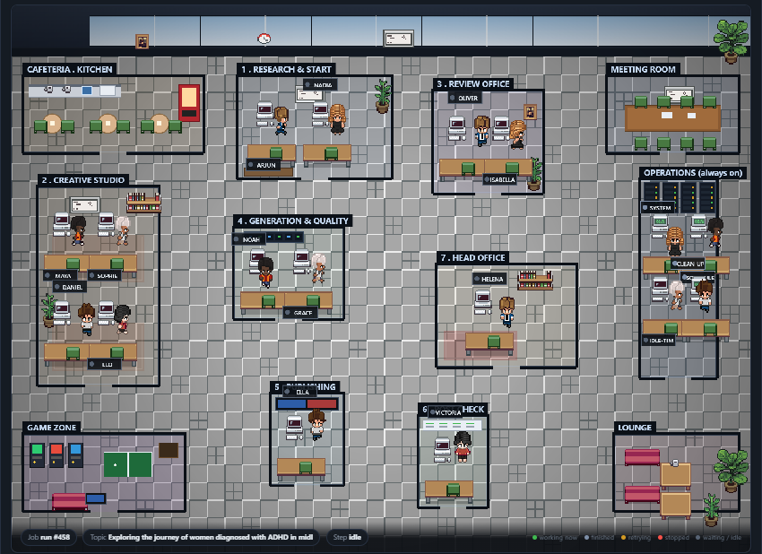
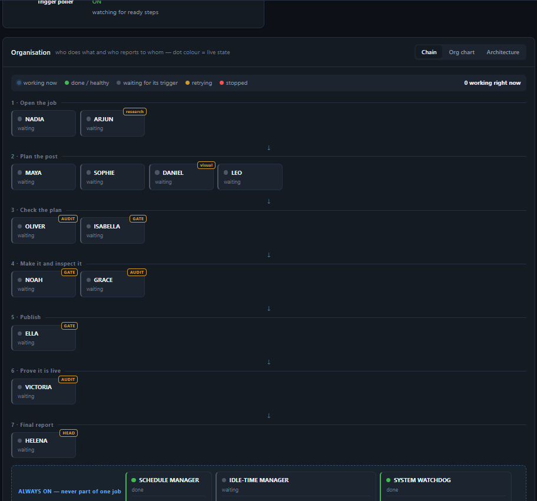
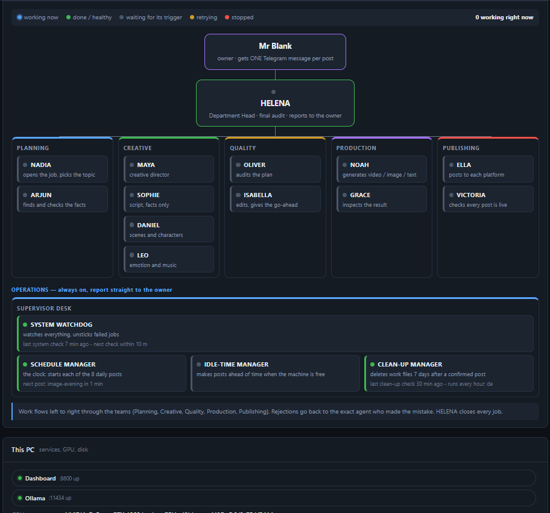
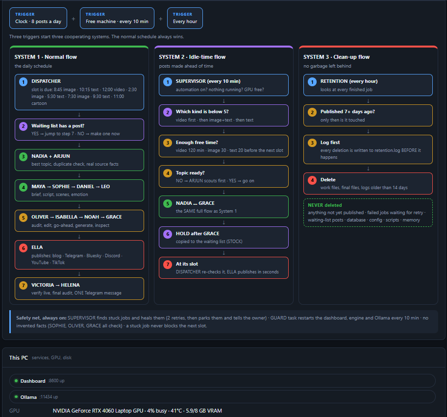
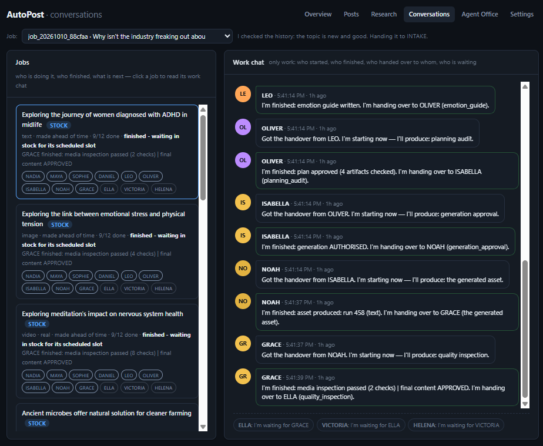
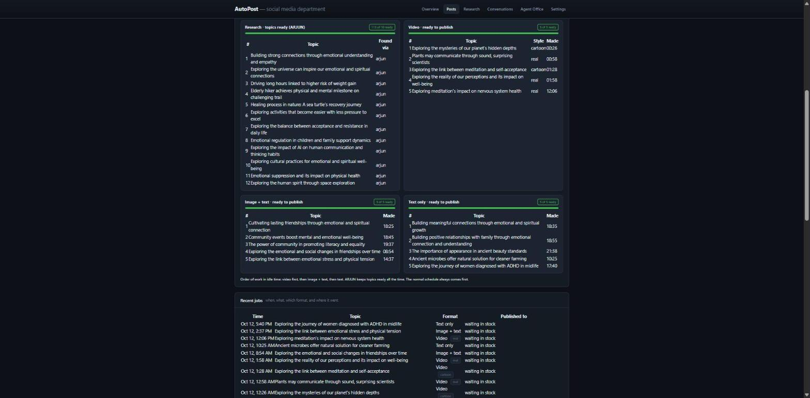
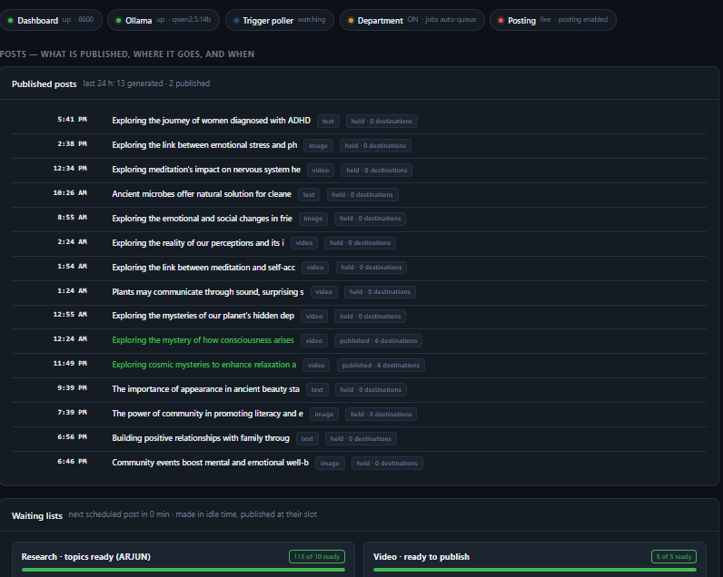

# AutoPost Automation

**Social Media Automation (Local Machine)**

Version 3.0 · Created by **Mr Blank** · Free to use, the author credit must stay (see [LICENSE](LICENSE))

AutoPost Automation runs on your own computer. A small team of software agents
finds topics, writes the posts, makes the pictures and videos, checks the facts,
publishes to your accounts on a daily schedule, and then checks that every post
really went live. You watch it all from one dashboard in your browser.

Nothing is sent to a cloud service to write your posts. The text is written by a
model that runs on your own machine (through Ollama).

---

## What you get

- **A team of 14 agents.** Each one has one job: research, script, scenes, music, checks, making the post, inspecting it, publishing and a final audit.
- **Three systems that work together.**
  1. The normal flow: eight posts a day at fixed times.
  2. The idle time flow: when the computer is free, it makes posts ahead of time and keeps them ready, so each scheduled post goes out within seconds.
  3. The clean up flow: it deletes old work files after a post is confirmed live, and never touches anything that is not published yet.
- **A live dashboard.** Status, a pixel office where you can watch the agents work, an organisation chart, a system map, the work chat of every job, the waiting lists and the settings.
- **Safe by default.** It starts paused, with no accounts connected, and posting switched off. Nothing goes out until you turn it on.
- **No invented facts.** Posts may only use names, numbers and quotes that came from a real source the research agent fetched. No source means no factual claims.
- **Self healing.** A watchdog agent finds stuck jobs and fixes them, and a guard restarts anything that stops.

## Screenshots

**The agent office.** Every agent has a desk. When they are not working they walk to the cafeteria, meeting room, game zone and lounge in the four corners.



**Organisation, chain view.** The seven stages a post goes through. The dot colour is the live state of each agent.



**Organisation, who reports to whom.**



**System map.** The three systems side by side.



**Conversations.** The work chat of one job, showing every handover between agents.



**Idle time management.** Posts made ahead of time, waiting for their slot.





## What computer do you need?

It was built and tested on this computer. Yours does not have to be this strong.

| | Reference computer (tested) | Comfortable | Minimum |
|---|---|---|---|
| System | Windows 11 | Windows 10 or 11 | Windows 10 or 11 |
| Processor | Intel Core i9-14900HX | 8 cores | 4 cores |
| Memory | 32 GB | 16 GB | 8 GB |
| Graphics card | NVIDIA RTX 4060 Laptop, 8 GB | not needed | not needed |
| Free disk space | 100 GB or more | 40 GB | 15 GB |
| Text model | qwen2.5:14b | qwen2.5:7b | qwen2.5:3b |
| What works | Everything, with local video | Text and image posts | Text posts |

Local video needs an NVIDIA graphics card with 8 GB or more. Without one, everything
else still works. The installer checks your computer and tells you what it can run.

## Quick start (copy, paste, done)

Open PowerShell and run these four lines, one at a time:

```
winget install --id Git.Git -e --silent
git clone https://github.com/pavelblank/autopost-automation.git
cd autopost-automation
.\INSTALL.bat
```

`INSTALL.bat` checks your computer, shows what you have and what is missing, installs the
missing parts (Python, FFmpeg, Ollama and the text model), connects to your local model and
ends with a readiness report. When it finishes:

```
.\CONNECT.bat
.\START.bat
```

`CONNECT.bat` asks simple questions and connects your social accounts. `START.bat` opens the
dashboard at `http://localhost:8600` (first login: `admin` and `change-me`, change it at once).

Something not working? Run `.\DOCTOR.bat`. It lists what is ready, what is missing, why, and
how to fix it. See [TROUBLESHOOTING.md](TROUBLESHOOTING.md) for common problems.

## Where it can post

Telegram, Telegram channel, Bluesky, Discord, Mastodon, YouTube, TikTok, X, Facebook Page,
Threads, LinkedIn, WordPress, your own blog, and a **Webhook** that reaches almost anything
else (Instagram, Pinterest, Reddit, Tumblr and more) through Zapier, Make or n8n.
Connect any of them with `.\CONNECT.bat`.

## Folder map

| Folder | What is inside |
|---|---|
| `scripts/` | The program: dashboard, engine, agents, publishers |
| `assets/` | Dashboard pages, office pictures, legal page templates |
| `config/` | Your settings. Example files only, your real files stay on your machine |
| `videogen/` | The agent roster (`AGENT_SPEC.json`) and the video tools |
| `tools/` | Tests and checks |
| `docs/` | How it works, screenshots |
| `data/`, `out/`, `logs/`, `STOCK/` | Created while it runs. Never uploaded |

## Author and license

AutoPost Automation was created by **Mr Blank**.
You can use it, change it, share it and build on it for free. You cannot remove
the author name or say the work is yours. The credit is kept in every file, in the
dashboard footer and in the logs, and it is protected by a digital signature that
only the author can create. Read [LICENSE](LICENSE) for the exact rules.

If you share a changed version, say it is a modified version of AutoPost
Automation by Mr Blank.

## More reading

- [INSTALL.md](INSTALL.md) step by step setup
- [TROUBLESHOOTING.md](TROUBLESHOOTING.md) common problems and how to fix them
- [USER-MANUAL.md](USER-MANUAL.md) daily use, every page, every setting
- [docs/HOW-IT-WORKS.md](docs/HOW-IT-WORKS.md) the agents, the three systems, what happens when something fails
- [CHANGELOG.md](CHANGELOG.md) what changed in version 3.0
